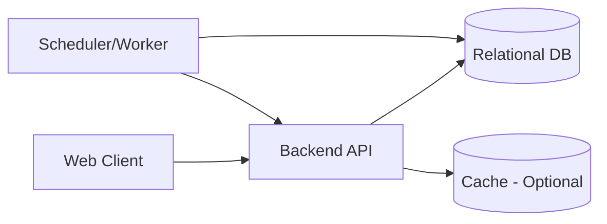

# HabitQuest TRD (Technical Requirements Document)

## 1. 문서 정보
- 문서명: TRD (Technical Requirements Document)
- 제품명: HabitQuest
- 버전: v0.2
- 작성일: 2026-08-30
- 기준 문서: IDEA.txt, PRD.md, AI-IDEA1.md
- 대상 릴리스: Phase 1 (MVP 웹 + AI 확장)

## 2. 기술 목표
- PRD의 MVP 기능을 안정적으로 구현 가능한 기술 구조를 정의한다.
- 서버 KST 기준 일일 리셋, 출석, 연속 달성, 시즌 랭킹을 일관되게 처리한다.
- 경제/랭킹 악용을 방지하는 정책(상한, 감산, 구매 제한)을 서버 권한으로 강제한다.
- Phase 2(AI 인증, AI 피드백, 모바일 확장)를 고려한 확장 가능한 구조를 마련한다.

## 3. 범위
### 3.1 포함 (MVP)
- 인증: 제외 (사전 정의 테스트 페르소나 기반 시작)
- 일일 퀘스트 3개 생성/완료
- 경험치/재화 지급 및 레벨업
- 출석/연속 기록/방지권 사용
- 상점(방지권 + 꾸미기 아이템)
- 월간 시즌 랭킹 포인트 집계 및 리셋
- 통계/프로필 조회
- 종료 전 미출석 경고 UX 지원을 위한 상태 API

### 3.2 제외 (MVP)
- AI 대화형 인증
- AI 난이도 피드백
- 모바일 네이티브 앱 배포

## 4. 아키텍처 개요
- 클라이언트: 웹 프런트엔드 (SPA)
- 백엔드: REST API 서버
- 데이터 저장소: 관계형 DB (트랜잭션 필요)
- 배치/스케줄러: 일일/월간 정기 작업
- 캐시(선택): 랭킹 조회 가속

## 5. 기술 스택 권장안
- 프런트엔드: React + TypeScript
- 백엔드: Node.js + TypeScript (예: NestJS 또는 Express)
- DB: PostgreSQL
- ORM: Prisma 또는 TypeORM
- 인증: JWT (Access/Refresh)
- 스케줄링: Cron 기반 Worker (서버 KST 기준)
- 배포: 웹 우선 배포 후 모바일 확장 고려

참고: 특정 프레임워크는 팀 역량에 따라 대체 가능하나, 타입 안정성과 배치 처리 용이성을 우선한다.

## 6. 도메인 모델
### 6.1 핵심 엔티티
- TestPersona
  - id, name, initialLevel, initialGold, initialStreak, initialStats, itemsPreset
- UserSession
  - personaId, sessionId, startedAt, lastActivityAt
- User
  - id, personaId, level, totalExp, gold, avatarUrl, avatarType, equippedBorder, equippedDecoration, createdAt
- HabitCategory
  - id, name
- DailyQuest
  - id, userId, categoryId, questDateKst, difficulty, status, completedAt
- QuestCompletionLog
  - id, userId, dailyQuestId, expReward, goldReward, rankingPointAwarded, createdAt
- Attendance
  - id, userId, dateKst, checked
- Streak
  - userId(PK), currentStreak, bestStreak, lastAttendanceDateKst
- Inventory
  - id, userId, itemType, quantity
- ShopPurchaseLog
  - id, userId, itemType, priceGold, purchasedAt, weekKeyKst
- RankingSeason
  - id, yearMonth, startAtKst, endAtKst, status
- RankingPointLog
  - id, userId, seasonId, dailyQuestId, basePoint, multiplier, penaltyRate, finalPoint, createdAt
- SeasonRewardLog
  - id, userId, seasonId, percentileBand, rewardType, rewardValue, grantedAt

### 6.2 UI & Graphics 및 AI 확장 사양
- Avatar System: 기본 아바타 이모지/일러스트 외에 커스텀 사진 업로드(DataURL/Image Blob) 및 상점 특수 프로필 이미지 지원
- Border & Decoration Overlay: 텍스트 표기 대신 CSS/SVG layer 오버레이로 프로필 아바타 주변에 테두리(Border ring) 및 장식(Flame, Crown, Aura 등) 시각화
- Compact Header Status Bar: 메인 화면의 메인 정보 카드를 제거하고 Header 탑바 영역에 연속 출석, 총 출석, 포인트, 골드, 레벨, EXP %를 콤팩트한 칩/배지로 통합
- AI Quest & Reroll: 사용자의 습관/노트/난이도를 세션 스토어에 보존하고, 리롤 티켓 사용 시 최초 요구사항을 전달하여 AI가 신규 3개 퀘스트를 동적 재창작

### 6.2 인덱스/제약
- DailyQuest: unique(userId, questDateKst, slotNo) 또는 생성 시 정확히 3개 보장
- Attendance: unique(userId, dateKst)
- RankingPointLog: index(userId, seasonId, createdAt)
- ShopPurchaseLog: index(userId, weekKeyKst, itemType)
- Inventory: unique(userId, itemType)

## 7. 정책 엔진 요구사항 (서버 강제)
### 7.1 퀘스트/출석
- 매일 사용자당 일일 퀘스트 3개 생성
- KST 00:00 리셋
- 하루 1개 이상 완료 시 출석 인정

### 7.2 연속 달성/방지권
- 30일 연속 출석 달성 시 방지권 1개 무료 지급
- 방지권 최대 보유 3개
- 연속 깨짐 예정 시 방지권 보유자에게 사용 선택 상태 제공
- 방지권 사용 시 해당 일자 연속 유지 처리

### 7.3 재화/상점
- 일일 재화 획득 상한: 300 골드
- 방지권 가격: 1000 골드
- 방지권 상점 구매: 주간 최대 2회
- 꾸미기 가격표
  - Common 100
  - Rare 300
  - Epic 700
  - Legendary 1500

### 7.4 랭킹
- 월간 시즌제, 시즌 종료 시 포인트 초기화
- 포인트 공식: base 10 x difficultyMultiplier
  - 쉬움 1.0, 보통 1.3, 어려움 1.6
- 동일 카테고리 반복 완료 3회차부터 20% 감산
- 일일 랭킹 포인트 획득 상한 60점
- 랭킹 표시 범위: 전체/친구/퍼센타일
- 시즌 보상
  - Top 1%: 전설 테두리
  - Top 10%: N시즌 Top 10% 칭호
  - Top 30%: 프로필 배경
  - 참가상: 600 골드

## 8. API 요구사항 (초안)
### 8.1 페르소나/세션 (인증 대체)
- GET /personas (테스트 페르소나 목록 조회)
- POST /session/start (페르소나 선택 및 세션 시작)
- GET /session/current (현재 세션 정보 조회)
- POST /session/end (세션 종료)

### 8.2 퀘스트
- GET /quests/daily
- POST /quests/{questId}/complete
- GET /quests/history

### 8.3 출석/연속/방지권
- GET /streak
- POST /streak/protection/use
- GET /attendance/today

### 8.4 보상/인벤토리/상점
- GET /wallet
- GET /inventory
- GET /shop/items
- POST /shop/purchase

### 8.5 랭킹
- GET /ranking/season/current
- GET /ranking/leaderboard?scope=global|friends|percentile
- GET /ranking/me

### 8.6 통계/프로필
- GET /profile
- GET /stats/monthly

### 8.7 공통 응답 규칙
- 모든 금전/포인트/보상 변경 API는 멱등 키(Idempotency-Key) 지원 권장
- 시간 필드는 ISO8601 UTC 저장, KST 파생 값은 서버 계산

## 9. 배치/스케줄 작업
- DailyQuestGenerateJob (매일 KST 00:00)
  - 대상 사용자 일일 퀘스트 3개 생성
- AttendanceCloseJob (매일 KST 00:05)
  - 전일 미출석 확정 및 연속 계산 보정
- MonthlySeasonCloseJob (매월 말일 23:59:59 KST 직후)
  - 시즌 순위 확정
  - 보상 지급
  - 시즌 포인트 리셋 및 신규 시즌 오픈

실패 복구 요구사항
- 잡 재실행 가능(멱등)
- 부분 실패 시 사용자 단위 재처리 큐 지원

## 10. 상태 전이 규칙
### 10.1 DailyQuest
- PENDING -> COMPLETED
- COMPLETED는 재완료 불가

### 10.2 Streak
- 유지 조건: 해당 dateKst 출석 true
- 깨짐 조건: 미출석 확정 && 방지권 미사용
- 보호 조건: 미출석 예정 시 방지권 사용 확정

## 11. 보안 요구사항
- 비밀번호 해시 저장(Argon2 또는 bcrypt)
- JWT 서명키 안전 보관
- 민감 API 인증 필수
- 권한 체크: userId 스코프 강제
- 속도 제한: 로그인/구매/완료 API rate limit
- 입력 검증: 스키마 기반 검증

## 12. 관측성/운영
- 로그
  - 인증, 퀘스트 완료, 보상 지급, 구매, 포인트 계산, 시즌 정산
- 메트릭
  - 일일 완료율, 출석율, 평균 연속일, 보상 지급 오류율, 잡 성공률
- 알림
  - 배치 실패, 포인트 계산 오류, 보상 지급 누락

## 13. 성능 목표 (MVP)
- P95 API 응답 시간
  - 조회 API: 500ms 이하
  - 완료/구매 API: 800ms 이하
- 랭킹 조회
  - 캐시 미사용 시 1초 이내, 캐시 사용 시 300ms 이내 목표

## 14. 테스트 요구사항
### 14.1 단위 테스트
- 포인트 계산식(난이도 계수, 반복 감산, 일일 상한)
- 재화 상한/방지권 제한/주간 구매 제한
- 연속 달성 및 방지권 사용 로직

### 14.2 통합 테스트
- 퀘스트 완료 -> 보상 -> 출석 -> 연속 반영
- 시즌 종료 -> 보상 지급 -> 리셋
- 중복 요청 시 멱등성 보장

### 14.3 E2E 테스트
- 회원가입/로그인
- 일일 퀘스트 완료 플로우
- 상점 구매 플로우
- 랭킹 조회 플로우(전체/친구/퍼센타일)

## 15. 데이터 마이그레이션/시드
- 카테고리 기본값 시드
- 상점 아이템/희귀도 가격표 시드
- 시즌 테이블 초기 시즌 생성

## 16. 테스트 페르소나 세션 정책
- 페르소나 선택 시 해당 페르소나의 초기 상태 로드
- 세션 중 변경사항(퀘스트 완료, 구매 등)은 메모리 또는 임시 저장소에 보관
- 세션 종료 또는 새 페르소나 선택 시 변경사항 폐기
- 페르소나 재선택 시 항상 초기 상태에서 시작
- 멀티 탭/창 동시 접속: 마지막 활동 페르소나 기준

## 17. 오픈 이슈
- 주요 레벨 마일스톤의 정확한 레벨 구간값
- 친구 랭킹의 친구 관계 모델(양방향/팔로우 기반)
- 퀘스트 새로고침 티켓의 MVP 포함 여부 및 가격

## 18. Phase 2 확장 포인트
- AI 인증 세션 테이블, 대화 로그 테이블 추가
- AI 난이도 제안 모델 입력 피처 설계
- 모바일 앱(BFF 또는 동일 API) 호환 인터페이스 유지
